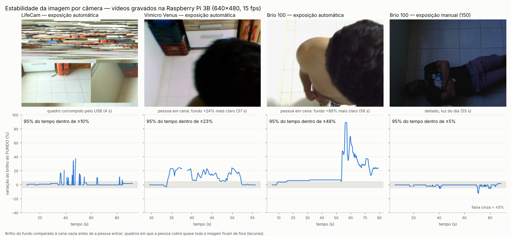

# Comparativo de câmeras USB na Raspberry Pi 3B

Este documento registra como a câmera do **Projeto Alerta de Queda** foi escolhida e configurada. Três webcams USB foram testadas na Raspberry Pi 3B com o detector por silhueta (`prototipo/silhueta.py`). A escolhida foi a **Logitech Brio 100 com exposição manual**, em 640×480 a 15 fps.

> **Resumo:** a Pi 3B apresentou perda de pacotes isócronos USB com webcam em 640×480 a 30 fps. A solução foi reduzir a taxa de quadros para 15 fps, compatível com a taxa de processamento da plataforma. Entre as câmeras sem perdas no USB, a Brio 100 foi a única que manteve o brilho da imagem estável, graças à exposição manual.

## 1. Por que a escolha da câmera importa

O detector usa **subtração de fundo** (OpenCV MOG2) [2]. Ele aprende a imagem do cômodo vazio e marca como "pessoa" todo pixel que fica diferente desse fundo. Por isso a câmera precisa de duas qualidades:

1. **Entregar quadros íntegros.** Um quadro corrompido muda a imagem inteira e vira uma "pessoa" do tamanho do quadro.
2. **Manter o brilho do fundo constante.** Webcams com exposição automática clareiam ou escurecem a imagem inteira quando alguém entra em cena. Para o detector, o chão inteiro passa a ser "pessoa".

O limite de tolerância vem dos parâmetros do detector: `varThreshold = 32` sobre a distância de Mahalanobis ao quadrado, com variância mínima `VAR_MIN_FUNDO = 60`, nos três canais de cor. Um pixel vira "pessoa" quando

$$3\,\delta^2 > 32 \times 60 \;\Rightarrow\; \delta > 25 \text{ níveis de cinza por canal}$$

Num chão de brilho ≈ 140 (escala 0–255), isso equivale a uma variação global de **≈ 18%**. Acima disso, a máscara se enche de falsos positivos.

## 2. Câmeras avaliadas

| | Microsoft LifeCam | Vimicro Venus | Logitech Brio 100 |
|:--|:--|:--|:--|
| Transmissão USB na Pi 3B | perde quadros: muitos a 30 fps, 0,1–0,4% a 15 fps | sem perdas | sem perdas |
| Exposição nos testes | automática (travada, a imagem satura) | automática | manual, valor 150 (15 ms); no automático oscila até 89% |
| Variação do brilho do fundo (p95) | 3–27% | 23% | 3–5% |
| Imagem | desfocada no teto, reflexo estourado | nítida, sem estouro | nítida, sem estouro |
| Detecção de queda no teto | alarme falso com pessoa em pé perto da lente | não testada no teto | quedas rápida e lenta detectadas |
| Decisão | descartada | reserva | **escolhida** |

Todos os testes usaram o mesmo modo: 640×480, YUYV, 15 fps. Os números vêm das medições da seção 4.

Especificações da Brio 100 informadas pelo fabricante: vídeo 1080p a 30 fps, sensor de 2 MP, campo de visão de 58° na diagonal e foco fixo [1]. O campo de visão é usado na estimativa de cobertura da seção 7.

## 3. Metodologia

- **Captura:** todos os vídeos foram gravados na própria Pi 3B, em 640×480, formato YUYV, 15 fps, com `silhueta.py --gravar`. A gravação guarda os quadros brutos, inclusive os corrompidos.
- **Quadros corrompidos:** um quadro conta como corrompido quando mais de 30% dos pixels mudam (diferença > 40 níveis) em relação aos dois vizinhos, mas os vizinhos são parecidos entre si (< 10%). É o padrão de um quadro isolado com faixas deslocadas, e não de movimento.
- **Variação do brilho do fundo:**
  1. A referência é a mediana de 2,5 s da cena vazia, antes de a pessoa entrar.
  2. Em cada quadro seguinte se calcula a razão quadro/referência pixel a pixel. O ganho global é a **moda** do histograma dessa razão: os pixels do fundo compartilham o mesmo ganho, e a pessoa fica fora do pico.
  3. Quadros em que menos de 25% dos pixels concordam com a moda (pessoa cobrindo quase toda a imagem) ficam de fora.
  4. São reportados os percentis 50 e 95 e o máximo de |ganho − 1|.
- **Pixels estourados:** fração da cena vazia com nível ≥ 250 (branco saturado, sem informação).
- **Ruído:** mediana do desvio-padrão temporal de cada pixel nos 2,5 s de cena vazia.

## 4. Resultados



| Vídeo | Câmera | Posição | Exposição | Duração | Quadros corrompidos | Brilho do fundo (p50 / p95 / máx.) | Pixels estourados | Ruído |
|:--|:--|:--|:--|--:|--:|:--|--:|--:|
| teste1 | LifeCam | canto | automática | 69 s | 1 (0,1%) | < 1% / 3% / 53% | 12,0% | 1,04 |
| teste2 | LifeCam | canto | automática | 92 s | 5 (0,4%) | < 1% / 10% / 37% | 10,7% | 0,90 |
| teste3 | LifeCam | teto | automática | 330 s | 21 (0,4%) | 19% / 27% / 51% | 4,3% | 1,33 |
| cam_vimicro | Vimicro | mesa, reposicionada | automática | 50 s | 0 | não medido: câmera em movimento | 0% | 0,81 |
| cam_vimicro2 | Vimicro | canto | automática | 56 s | 0 | 9% / 23% / 24% ¹ | 0% | 1,18 |
| cam_brio | Brio 100 | teto | automática | 54 s | 0 | não medido: sem pessoa em cena | 0% | 1,08 |
| cam_brio2 | Brio 100 | teto | automática | 79 s | 0 | 7% / 48% / 89% | 0% | 0,61 |
| cam_brio3 | Brio 100 | teto | manual 150 (noite) | 61 s | 0 | < 1% / 3% / 6% | 0% | 0,97 |
| cam_brio4 | Brio 100 | teto | manual 150 | 59 s | 0 | < 1% / 3% / 6% | 0% | 0,88 |
| cam_brio5 | Brio 100 | teto | manual 150 | 59 s | 0 | 2% / 3% / 14% | 0% | 0,68 |
| cam_brio6 | Brio 100 | teto | manual 150 (dia) | 89 s | 0 | < 1% / 5% / 13% | 0% | 0,66 |

¹ Medido a partir de 27 s, depois que a câmera parou de ser reposicionada.

## 5. Discussão

### 5.1 Problema na captura pela webcam USB (LifeCam)

**Sintoma.** Ao capturar em 640×480 na Pi 3B, os quadros saíram corrompidos:

- faixas horizontais deslocadas;
- blocos de cor errada;
- a parte de baixo do quadro vazia, em cinza ou verde.

A câmera funcionava, mas os quadros chegavam incompletos (figura, primeiro quadro).

**Causa: perda de dados no USB.**

- Webcams enviam vídeo por transferência **isócrona**, que tem banda reservada mas **não reenvia pacotes perdidos**. Se um pacote não chega a tempo, aquele pedaço da imagem simplesmente falta.
- Na Pi 3B, as quatro portas USB e a Ethernet dividem **um único canal USB 2.0** do SoC, por meio do chip LAN9514 [3]. O controlador desse canal não deu conta do fluxo da câmera em 640×480 a 30 fps.
- Em YUYV são 2 bytes por pixel. A 30 fps, isso dá 640 × 480 × 2 × 30 ≈ **18,4 MB/s**, cerca de 75% do máximo teórico de um único canal isócrono USB 2.0 (24,6 MB/s).
- **Confirmação:** ao reduzir a resolução para 320×240 (≈ 4,6 MB/s), as imagens saíram perfeitas. O problema é o volume de dados, e não a câmera. No notebook, que tem controlador USB próprio, a mesma LifeCam teve 0% de quadros corrompidos.

**Problema secundário: porta com falha elétrica.** A primeira porta usada apresentava falha: o sistema registrou erro de interferência eletromagnética (EMI) e desconectou a câmera. A troca de porta resolveu esse ponto.

**Solução: reduzir o fluxo da câmera.** A captura foi configurada em **640×480 a 15 fps** (≈ 9,2 MB/s, metade do fluxo). Capturar a 30 fps não traria ganho para a detecção (seção 6.2).

**Resultado.**
- **LifeCam:** ainda perde 0,1–0,4% dos quadros a 15 fps. O `silhueta.py` detecta e descarta esses quadros (`QUADRO_CORROMPIDO`).
- **Vimicro e Brio:** foram estáveis no USB.
- **Hipótese ainda não verificada:** a LifeCam reserva mais banda isócrona que as outras. Isso pode ser conferido com `lsusb -v` (campo `wMaxPacketSize` das configurações alternativas).
- **Imagem:** no teto, a LifeCam também produziu imagem desfocada e um reflexo estourado (4% dos pixels). Ao travar a exposição, a imagem ficou saturada.

### 5.2 Vimicro Venus: USB estável, exposição instável

Zero quadros corrompidos, mas a exposição automática clareou o fundo em até **24%** com a pessoa em cena. Isso fica acima do limite de ≈ 18% da seção 1.

### 5.3 Brio 100: a pior no automático, a melhor no manual

- **Automático:** é a mais agressiva das três. Com a pessoa perto da lente, o fundo chegou a **+89%** (cam_brio2) e ficou acima de +20% por mais de 20 s depois. Com isso, a máscara cobre o chão inteiro.
- **Manual** (`auto_exposure=1`, `exposure_time_absolute=150`, balanço de branco automático desligado): o fundo fica dentro de **±3–5%** em 95% do tempo, de dia e de noite. Isso está bem abaixo do limite.
- **Zero quadros corrompidos** em 401 s de gravação.
- A correção de brilho por software do `silhueta.py` existe para câmeras em modo automático. Com a exposição manual ela é desnecessária e passou a ser desligada (com ela ligada, a imagem do cam_brio6 oscilava).

### 5.4 Por que a Brio (Full HD) foi melhor que a Vimicro (resolução próxima da usada)

1. **Pelo USB passa o modo pedido, não a resolução do sensor.**
   - As três câmeras recebem o mesmo pedido: 640×480, YUYV, 15 fps, ou seja, ≈ 9,2 MB/s.
   - A Brio reduz a imagem de Full HD para 640×480 dentro dela, antes do USB. Por isso o sensor maior não consome banda a mais.
2. **No USB, Brio e Vimicro empataram.** As duas tiveram zero quadros perdidos. A falha da LifeCam depende da forma como cada câmera usa a transferência isócrona no barramento compartilhado, e não da resolução.
3. **A diferença decisiva foi o controle de exposição.**
   - A Brio aceita exposição manual pelo V4L2 e a mantém fixa, com variação de 3–5%.
   - A Vimicro, no automático, oscilou 23%, acima do limite de ≈ 18%.
   - No automático, a Brio foi a pior das três (+89%). Ela só é a melhor por permitir o controle manual.
4. **Resolução maior ajuda pouco aqui.** Reduzir uma imagem grande calcula a média de vários pixels e diminui o ruído, mas o ruído medido ficou parecido nas duas (seção 5.5).

**Ressalvas:**
- A Vimicro não foi testada com exposição manual. Se aceitar esse controle, pode ter desempenho próximo.
- A Brio tem um custo: o sensor é 16:9, e em 640×480 (4:3) ela provavelmente recorta as laterais, o que estreita o campo de visão (seção 7).

### 5.5 Ruído

Fica entre 0,6 e 1,3 níveis de cinza nas três câmeras, muito abaixo do limite de 25 níveis. **Não é um critério que diferencia as câmeras** neste projeto.

## 6. Escolha da resolução e da taxa de quadros

### 6.1 Resolução: captura em 640×480, processamento em 320×240

| Etapa | Resolução | Motivo |
|:--|:--|:--|
| Captura (USB) | 640×480 | A câmera reduz a imagem no próprio hardware. A foto enviada ao cuidador mantém detalhe suficiente para reconhecer a cena. |
| Processamento | 320×240 | 4 vezes menos pixels que 640×480. A subtração de fundo e a análise da mancha têm custo proporcional ao número de pixels, então o processamento fica ≈ 4 vezes mais leve e rápido na CPU da Pi 3B. |

A resolução menor é suficiente porque o detector analisa a **forma** da mancha, e não detalhes:

- A 2,5 m de altura, cada pixel de 320×240 corresponde a ≈ 6 mm do chão (seção 7).
- Uma pessoa deitada ocupa centenas de pixels de comprimento.

### 6.2 Taxa de quadros: 15 fps

- **Banda USB:** 15 fps reduz o fluxo à metade (≈ 9,2 MB/s) e elimina a perda de quadros observada a 30 fps (seção 5.1).
- **Detecção:** uma queda dura de ≈ 0,5 s a 1,5 s. A 15 fps, isso dá de 8 a 22 quadros por queda, mais que suficiente para:
  - a confirmação de 0,5 s em postura deitada (`CONFIRMA_S`, ≈ 7 quadros);
  - a janela de queda rápida de 1,5 s (`JANELA_QUEDA_S`).
- **Requisito:** 15 fps é o valor do REQ-01.
- **Processamento:** se o detector ficar mais lento que a captura, a _thread_ produtora descarta quadros antigos e o detector sempre analisa o mais recente (`src/firmware/captura_teste.cpp`). Capturar mais quadros do que é possível processar só gastaria banda USB e CPU.

## 7. Ângulo de abertura e área capturada

A largura do chão coberta por uma câmera no teto, apontada para baixo, é

$$L = 2\,h\,\tan\!\left(\frac{\text{FOV}}{2}\right)$$

em que _h_ é a distância da lente ao chão e FOV é o ângulo de abertura naquela direção.

### 7.1 Ângulo de abertura da Brio em 640×480

O fabricante informa 58° na diagonal [1], medido no formato 16:9 do sensor. Por geometria:

| Formato | Horizontal | Vertical |
|:--|:--:|:--:|
| 16:9 (sensor completo) | ≈ 52° | ≈ 30° |
| 4:3 (640×480, recortado do 16:9) | ≈ 40° | ≈ 30° |

### 7.2 Área coberta com a Brio (estimativa para 640×480 com recorte)

| Distância da lente ao chão | Área coberta | Tamanho de 1 pixel em 320×240 |
|:--|:--|:--:|
| 2,1 m (teste atual) | ≈ 1,5 m × 1,1 m | ≈ 5 mm |
| 2,5 m | ≈ 1,8 m × 1,4 m | ≈ 6 mm |
| 2,7 m | ≈ 2,0 m × 1,5 m | ≈ 6 mm |
| 3,0 m | ≈ 2,2 m × 1,6 m | ≈ 7 mm |

**Consequências:**

- **A 2,1 m, uma pessoa deitada (≈ 1,7 m) não cabe na imagem.** É por isso que o corpo sai cortado pela borda no cam_brio6, e o detector precisou de uma regra para corpo cortado.
- **Para caber uma pessoa deitada em qualquer orientação**, os dois lados precisam ter ≈ 2 m. Com o campo vertical de 30°, isso exigiria a lente a ≈ 3,7 m do chão, acima do pé-direito de uma casa (2,5–2,8 m).
- **Na altura viável (≈ 2,5–2,7 m), a Brio monitora uma faixa do cômodo** de ≈ 1,8–2,0 m × 1,4–1,5 m, como o espaço ao lado da cama ou o banheiro. Essa é uma condição de uso do sistema.

### 7.3 Lentes mais abertas a 2,5 m de altura

| FOV horizontal | Largura coberta |
|:--:|:--:|
| 60° | ≈ 2,9 m |
| 90° | ≈ 5,0 m |
| 120° | ≈ 8,7 m |

Uma lente grande angular (≥ 90°) cobriria um cômodo inteiro. Em troca, tem distorção de barril e cada pixel cobre mais área. Fica como melhoria futura, já prevista como opcional no projeto de hardware.

**Validação:** medir com trena a área coberta na altura final. Se o modo 640×480 não recortar o sensor, a área real será maior que a estimada.

## 8. Decisão

A câmera do projeto é a **Logitech Brio 100 em 640×480, YUYV, 15 fps, com exposição manual** (`--exposicao 150`), processada em 320×240. Motivos:

- ela é a única que reúne transmissão USB sem perdas na Pi 3B e brilho de fundo estável;
- é a única com quedas detectadas corretamente nos testes com câmera no teto.

A **Vimicro** fica como reserva. A **LifeCam** foi descartada para a Pi 3B.

## 9. Limitações e próximos testes

1. **Os testes não foram controlados.** Cada câmera foi gravada numa posição e numa cena diferentes, então os números indicam tendências.
   - **Próximo teste:** gravar 60 s com cada câmera na mesma posição do teto, com a mesma iluminação e o mesmo roteiro (cena vazia por 10 s, entrar, andar, deitar por 20 s, levantar, sair).
2. **Altura da câmera.** Os testes foram feitos a 2,1 m. O próximo passo é instalar a câmera a ≥ 2,5 m e medir a área coberta (seção 7).
3. **Exposição fixa.** Ao longo do dia, o brilho da imagem acompanha a luz ambiente. Variações lentas são absorvidas pelo aprendizado contínuo do fundo, mas a exposição ideal muda entre dia e noite.
   - **Proposta:** reajustar a exposição automaticamente só com o cômodo vazio e, em seguida, reaprender o fundo.

## 10. Como reproduzir

Ajuste da Brio 100 (o `silhueta.py --exposicao 150` faz o mesmo automaticamente):

```
v4l2-ctl -d /dev/video0 --set-ctrl=auto_exposure=1
v4l2-ctl -d /dev/video0 --set-ctrl=exposure_time_absolute=150
v4l2-ctl -d /dev/video0 --set-ctrl=white_balance_automatic=0
```

Gravação de um teste. O valor de `exposure_time_absolute` é dado em unidades de 100 µs, então 150 = 15 ms:

```
python3 SOE_template/prototipo/silhueta.py --exposicao 150 --web 8080 --gravar teste.avi
```

## Referências

[1] Logitech Brio 100 — especificações (resolução, campo de visão, foco). B&H Photo. Disponível em: <https://www.bhphotovideo.com/c/product/1786643-REG/logitech_960_001580_brio_100_full_hd.html/specs>.

[2] OpenCV — `cv::BackgroundSubtractorMOG2` (parâmetros `varThreshold` e `varMin`). Disponível em: <https://docs.opencv.org/4.x/d7/d7b/classcv_1_1BackgroundSubtractorMOG2.html>.

[3] Raspberry Pi Ltd. — documentação do Raspberry Pi 3 Model B (USB e Ethernet via LAN9514). Disponível em: <https://www.raspberrypi.com/documentation/computers/raspberry-pi.html>.
